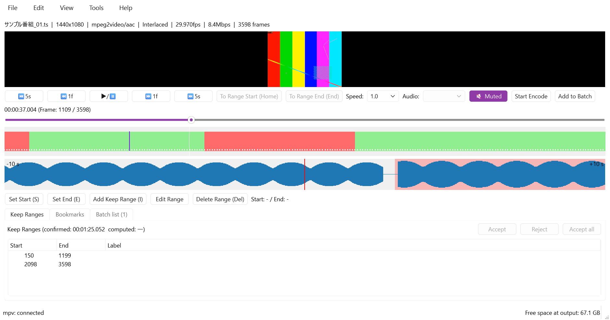

# TS_SmartCut

English | [日本語](README_jp.md)

A desktop app for Windows and Linux that cuts commercials and other unwanted parts out of Japanese TV recordings (TS files with MPEG-2 or H.264/AVC video). It only cuts: there is no conversion of codecs or containers (the output has the source's codec, format and extension).
**Smart Cut** re-encodes only around each cut point and stream-copies the rest, so cuts are frame-accurate and fast, with almost no loss of quality.



## Features

- **Edit cuts while previewing**: an mpv preview (play/pause, frame and 5-second steps, playback speed, jump to the previous/next keyframe), add/edit/delete keep ranges, undo/redo, a colour-coded timeline, the audio waveform of ±10 s around the current position, bookmarks
- **Automatic cut proposals**: opening a broadcast recording proposes the keep ranges without the commercials. You accept or reject each proposal (a human always makes the final decision). The proposals get better as more recordings are cut
- **Three processing modes**: Smart Cut (re-encode only around the cuts), Simple Copy (cut at keyframes, no re-encoding) and Full Re-encode (re-encode the keep ranges with the source's codec, scan type and bitrate)
- **Batch processing**: writes several recordings in turn (stop, skip, retry); you can keep editing the next recording meanwhile
- **Hardware encoder detection** (NVIDIA / AMD / Intel, otherwise software)
- **AviSynth / VapourSynth script output** (to hand the cut over to an encoder)
- **Key presets**: up to 5 sets of key assignments, so a small controller in keyboard mode can drive the app
- Japanese / English UI, light / dark / system theme
- The source file is never overwritten (the output always gets another name)

How to use it: **[User Guide (docs/User_Guide.md)](docs/User_Guide.md)**.

## How Smart Cut works

```
 keep range start                                          keep range end
    │ Head          │ Body                      │ Tail          │
    │ (re-encoded)  │ (-c copy, keyframe to     │ (re-encoded)  │
    │               │  keyframe)                │               │
    └──────────────────── joined with the concat demuxer ───────┘
```

- Head and Tail are re-encoded with **the source's own codec** (MPEG-2 / H.264), so codecs are never mixed.
- The scan structure is kept frame by frame: on MPEG-2 broadcast recordings (soft telecine mixed with interlaced video), every re-encoded frame keeps the source's display flags (progressive / interlaced, field order, repeated fields).
- Audio is not re-encoded; it is cut at the same points as the video and joined (no audio from the removed parts).
- Variable frame rate (VFR) sources switch to Simple Copy automatically.

## Requirements

- Windows 10 / 11 (64-bit) or Linux (x86-64, glibc 2.39 or later: distributions of the Ubuntu 24.04 generation or newer)
- **ffmpeg / ffprobe 8 or later** on PATH — not bundled. Older versions misbehave: 7.x re-encodes interlaced H.264 as gray pictures, 6.x reports no progress for stream copy (Ubuntu 24.04's own package is 6.1; use a newer build there). The app warns at startup when ffmpeg is older
- **mpv (libmpv)** for the preview — not bundled. Without it the app still starts and all cut editing works (only the preview is missing)
  - Windows: put `libmpv-2.dll` (or `mpv-2.dll`) in a folder on PATH
  - Linux: install your distribution's mpv / libmpv package

## Installation

### Windows

1. Download `TS_SmartCut-<version>-setup.exe` from [Releases](https://github.com/babaken/TS_SmartCut/releases) and run it.
2. No administrator rights are needed. It installs into `%LOCALAPPDATA%\Programs\TS_SmartCut` (the app writes its settings, history DB and logs next to itself, so it can't live in Program Files).
3. At the end it tells you if ffmpeg, ffprobe or libmpv was not found on PATH.

To update, run the newer installer (settings and records are kept). Uninstall from Settings → Apps; it asks whether to delete the settings and records too (default: keep them).

### Linux

```bash
tar xzf TS_SmartCut-<version>-linux64.tar.gz
cd TS_SmartCut-<version>-linux64
sh install.sh
```

- No root needed. It installs into `~/.local/share/TS_SmartCut` and adds "TS_SmartCut" to the application menu.
- Update the same way. Uninstall with `sh ~/.local/share/TS_SmartCut/uninstall.sh` (it asks whether to delete the settings and records too).

### From source

Needs Python 3.10 or later and Rust ([rustup](https://rustup.rs/)).

```bash
git clone https://github.com/babaken/TS_SmartCut.git
cd TS_SmartCut
python -m venv .venv
source .venv/bin/activate          # Windows: .venv\Scripts\Activate.ps1
pip install -r requirements.txt
pip install ./native               # the Rust part of the automatic cut; reinstall when native/ changes
python -m ts_smartcut.main
```

Windows details: [docs/TS_SmartCut_Windows_Setup.md](docs/TS_SmartCut_Windows_Setup.md) (in Japanese). `scripts/` has launchers (`run_ts_smartcut.bat` starts without a console window on Windows; `run_ts_smartcut.sh` can be used from a `.desktop` file on Linux).

## Where settings and records live

Settings, the history DB and logs are kept in the executable's folder (the repository root when running from source): `settings.json`, `shortcut_presets.json`, `recent_files.json`, `hardware_encoders.json`, `cut_history.db`, `logs/ts_smartcut.log`, `Logo/` (station logo `.lgd` files), `KeyframeCache/`, `Temp/`. The app refuses to start from a folder it can't write to. The history DB (SQLite in WAL mode) does not work correctly over a network, so keep the app on your own PC.

## FAQ

**Q. If I cut out 4 commercial breaks, how many output files do I get?**
One: the keep ranges joined into a single file. When one recording holds several episodes, add it to the batch several times, once per episode, under different names.

**Q. Does the quality drop?**
Smart Cut re-encodes only around each cut (up to the next keyframe, a few frames to about a second) with the source's codec and bitrate. Everything else is copied unchanged.

**Q. Can it convert to MP4 or H.264?**
No. It only cuts; the output has the source's codec, format and extension.

**Q. Does it use the GPU?**
It detects usable hardware encoders at first launch and uses them for re-encoding (see Settings → Encoding). Keeping the soft-telecine structure of MPEG-2 always uses the CPU.

**Q. What happens to soft telecine in H.264 (AVC) recordings?**
The pictures you see are the same, but re-encoded parts become hard-telecined 29.97i (MPEG-2 keeps its original structure).

## Troubleshooting

| Problem | Cause and fix |
|---|---|
| The preview area says "mpv: unavailable (preview-limited mode)" | libmpv was not found. On Windows put `libmpv-2.dll` in a folder on PATH; on Linux install the libmpv package |
| The output freezes in VLC (especially after seeking) | VLC's hardware decoding; it happens with the source too. Turn off hardware-accelerated decoding in VLC, or play it with mpv |
| No preview sound, or sound from the wrong device | Choose the device in Settings → Preview → Audio output device |
| [E302] Unsupported codec | The video is not MPEG-2 / H.264. Switch the batch item to Simple Copy (right-click) |
| [E004] Not enough disk space | The output and temporary files need room (about twice the kept part on one drive). Free up space on that drive |
| [E101] ffmpeg error | ffmpeg may be too old (8 or later is needed). See the log |
| It won't start, with [E505] | The app's folder is not writable. Put it in a writable folder (the installers do) |
| A `.ts_smartcut_temp` folder is left in the output folder | Left when the app ended during processing. It is removed the next time processing starts in that folder; you may delete it yourself |

The log is `logs/ts_smartcut.log` (see "Where settings and records live").

## Development

```bash
pip install -e ".[dev]"            # pytest, and numpy (used by the tests only)
pytest
```

The tests use the real ffmpeg / ffprobe / mpv / Qt instead of mocks. The release files (the Windows installer and the Linux tar.gz) are made with `python build_release.py` ([docs/TS_SmartCut_Packaging.md](docs/TS_SmartCut_Packaging.md), in Japanese).

## License

MIT License ([LICENSE](LICENSE)). The licenses of the other software in the release files are in [THIRD_PARTY_NOTICES.md](THIRD_PARTY_NOTICES.md).

## Acknowledgements

Reading the broadcast programme information and the ARIB STD-B24 character coding is based on [rplsTOOL](https://github.com/tsukumijima/rplsTOOL), through the author's own C# port of it (rplstool-cs, not published). The character tables are generated from `characterSets.cpp` of [rplsinfo](https://github.com/tsukumijima/rplsinfo). Thanks to the author of rplsTOOL and rplsinfo.
