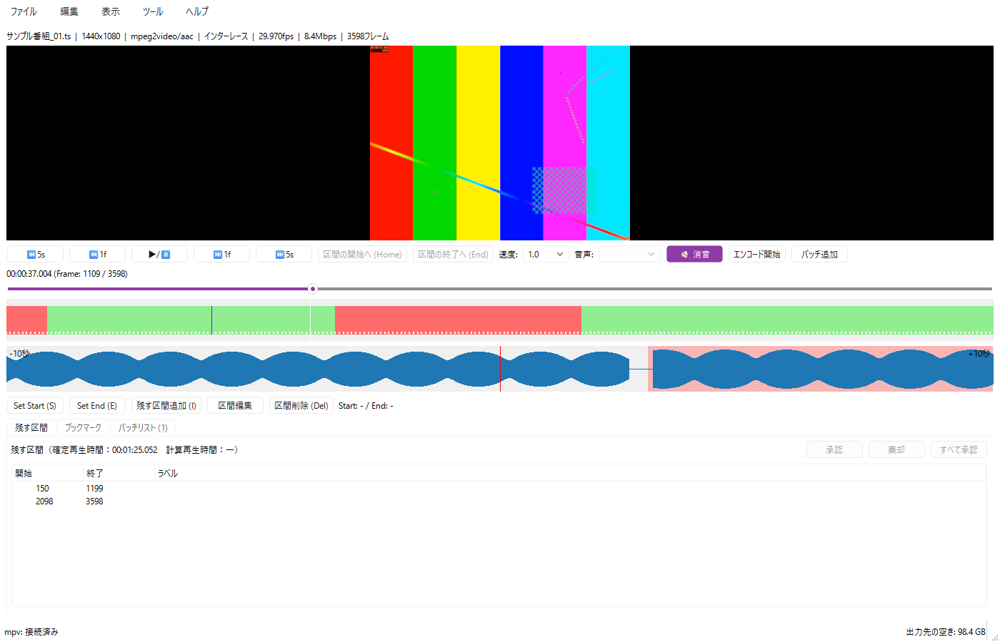

# TS_SmartCut

[English](README.md) | 日本語

テレビ録画の TS ファイル（映像は MPEG-2 または H.264/AVC）から CM・不要な区間をカットする、Windows / Linux 対応のデスクトップアプリです。目的はカットだけで、コーデックやコンテナの変換はしません（出力は元と同じコーデック・形式・拡張子です）。
切れ目の前後だけを再エンコードし、残りはストリームコピーする **Smart Cut** で、画質をほぼ落とさずに、速く、フレーム単位で正確にカットできます。



## 主な機能

- **プレビューしながらカットを編集**: mpv によるプレビュー（再生/一時停止、フレーム送り・戻し、5 秒送り・戻し、再生速度、前後のキーフレームへ移動）、残す区間の追加・編集・削除、元に戻す/やり直す、色分けしたタイムライン、今の位置の前後 10 秒の音声波形、ブックマーク
- **自動カットの案**: 放送の録画を開くと、CM を除いた「残す区間の案」を出します。案ごとに承認・棄却して使います（最後に決めるのは人です）。カットした録画が増えるほど、案は良くなります
- **3 つの処理モード**: Smart Cut（切れ目の前後だけ再エンコード）・Simple Copy（キーフレームの位置でカット、再エンコードなし）・Full Re-encode（残す区間を全部、元と同じコーデック・走査方式・ビットレートで再エンコード）
- **バッチ処理**: 複数の録画を順に書き出します（停止・スキップ・再試行）。処理中も次の録画を編集できます
- **ハードウェアエンコーダーの自動判定**（NVIDIA / AMD / Intel、使えなければソフトウェア）
- **AviSynth / VapourSynth のスクリプトの出力**（エンコードソフトへ渡す形）
- **キーの割り当て**: プリセットを 5 つまで作れ、キーボードモードの小型のコントローラーでも操作できます
- 日本語 / 英語の画面、ライト / ダーク / OS に従うテーマ
- 元のファイルは上書きしません（出力は常に別の名前）

使い方は **[使い方の資料（docs/User_Guide_jp.md）](docs/User_Guide_jp.md)** にあります。

## Smart Cut の仕組み

```
 残す区間の始まり                                         残す区間の終わり
    │ Head          │ Body                    │ Tail          │
    │ (再エンコード) │ (-c copy, Iフレーム間)   │ (再エンコード) │
    └──────────────────── concat demuxer で連結 ─────────────────┘
```

- Head / Tail は**元と同じコーデック**（MPEG-2 / H.264）で再エンコードするので、コーデックが混ざりません。
- 走査方式をフレームごとにそのまま保ちます。MPEG-2 の放送録画（アニメのソフトテレシネとインターレースの混在）でも、再エンコードした部分の各フレームの表示の指示（プログレッシブ／インターレース、フィールドの順、フィールドの繰り返し）は元と同じです。
- 音声は再エンコードせず、映像と同じ位置で切り出してつなぎます（カットした区間の音声は入りません）。
- 可変フレームレート（VFR）の素材は、自動で Simple Copy になります。

## 必要なもの

- Windows 10 / 11（64 ビット）または Linux（x86-64、glibc 2.39 以降。Ubuntu 24.04 以降と同じ世代のディストリビューション）
- **ffmpeg / ffprobe（8 以降）** … PATH の上に必要です。同梱していません。古い版は正しく動きません（7.x はインターレースの H.264 を作り直すと灰色の絵になり、6.x はコピーの進捗が出ません）。Ubuntu 24.04 の標準のパッケージは 6.1 なので、新しいビルドを使ってください。古い時は起動の時に知らせます
- **mpv（libmpv）** … プレビューに使います。同梱していません。無くても起動し、カットの編集はすべて使えます（プレビューが出ないだけです）
  - Windows: `libmpv-2.dll`（または `mpv-2.dll`）を PATH の通ったフォルダに置きます
  - Linux: ディストリビューションの mpv / libmpv のパッケージを入れます

## インストール

### Windows

1. [Releases](https://github.com/babaken/TS_SmartCut/releases) から `TS_SmartCut-<版>-setup.exe` を落とし、実行します。
2. 管理者の権限は要りません。`%LOCALAPPDATA%\Programs\TS_SmartCut` に入ります（設定・記録 DB・ログをアプリと同じフォルダに書くので、Program Files には入れません）。
3. 最後に、ffmpeg・ffprobe・libmpv が PATH に見つからなければ知らせます。

更新は新しい版のインストーラーを実行するだけです（設定と記録はそのまま）。削除は「設定 → アプリ」から行います。設定と記録も消すかを尋ねます（既定は残します）。

### Linux

```bash
tar xzf TS_SmartCut-<版>-linux64.tar.gz
cd TS_SmartCut-<版>-linux64
sh install.sh
```

- root は要りません。`~/.local/share/TS_SmartCut` に入り、アプリのメニューに「TS_SmartCut」が出ます。
- 更新も同じ手順です。削除は `sh ~/.local/share/TS_SmartCut/uninstall.sh`（設定と記録も消すかを尋ねます）。

### ソースから動かす

Python 3.10 以上と Rust（[rustup](https://rustup.rs/)）が要ります。

```bash
git clone https://github.com/babaken/TS_SmartCut.git
cd TS_SmartCut
python -m venv .venv
source .venv/bin/activate          # Windows: .venv\Scripts\Activate.ps1
pip install -r requirements.txt
pip install ./native               # 自動カットの計算の部品（Rust）。native/ が変わったら入れ直す
python -m ts_smartcut.main
```

Windows の詳しい手順は [docs/TS_SmartCut_Windows_Setup.md](docs/TS_SmartCut_Windows_Setup.md) にあります。`scripts/` に起動用のスクリプトがあります（Windows はコンソールの窓が出ない `run_ts_smartcut.bat`、Linux は `.desktop` から使える `run_ts_smartcut.sh`）。

## 設定と記録の置き場所

設定・記録 DB・ログは、実行ファイルと同じフォルダ（ソースから動かす時はリポジトリの直下）に置きます: `settings.json`・`shortcut_presets.json`・`recent_files.json`・`hardware_encoders.json`・`cut_history.db`・`logs/ts_smartcut.log`・`Logo/`（局ロゴの `.lgd`）・`KeyframeCache/`・`Temp/`。書き込めないフォルダに置くと起動しません。記録 DB（SQLite の WAL）はネットワークの上では正しく動かないので、アプリは自分の PC に置いてください。

## FAQ

**Q. CM を 4 つカットしたら、出力は何ファイルになりますか？**
1 ファイルです。残す区間をつないだ 1 つのファイルになります。1 本の録画に何話か入っている時は、話ごとに別の名前で何回かバッチに追加できます。

**Q. 画質は落ちますか？**
Smart Cut では、切れ目の前後（次のキーフレームまでの数フレーム〜1 秒ほど）だけを元と同じコーデック・ビットレートで再エンコードします。それ以外は元のデータをそのままコピーします。

**Q. MP4 にしたり、H.264 にしたりできますか？**
できません。カット専用で、出力は元と同じコーデック・形式・拡張子です。

**Q. GPU は使いますか？**
最初の起動の時に判定し、使える時は再エンコードに使います。結果は「設定 → エンコード」で見られます。MPEG-2 のソフトテレシネの構造を保つ処理は、いつも CPU です。

**Q. H.264（AVC）の録画のソフトテレシネはどうなりますか？**
表示される映像は元と同じですが、再エンコードした部分はテレシネ済みの 29.97i になります（MPEG-2 は元の構造のまま保ちます）。

## トラブルシューティング

| 症状 | 原因と対処 |
|---|---|
| プレビューの所に「mpv: 利用不可（プレビュー制限モード）」と出る | libmpv が見つかりません。Windows では `libmpv-2.dll` を PATH の通ったフォルダに、Linux では libmpv のパッケージを入れてください |
| 出力を VLC で再生すると映像が止まる（特にシークの後） | VLC のハードウェアデコードの問題で、元の録画でも起きます。VLC の「ハードウェアアクセラレーションによるデコード」を無効にするか、mpv で再生してください |
| プレビューの音が出ない・別の機器から出る | 「設定 → プレビュー → 音声出力デバイス」で出力先を選んでください |
| [E302] コーデック非対応 | 映像が MPEG-2 / H.264 以外です。バッチリストの右クリックで Simple Copy にしてください |
| [E004] 空き容量不足 | 出力と一時ファイルの分が要ります（同じドライブなら、残す部分のおよそ 2 倍）。そのドライブの空きを増やしてください |
| [E101] ffmpeg の実行エラー | ffmpeg が古いかもしれません（8 以降が必要です）。ログを見てください |
| [E505] で起動しない | アプリのフォルダに書き込めません。書き込めるフォルダに置いてください（インストーラーは書き込める場所に入れます） |
| 出力先に `.ts_smartcut_temp` が残っている | 処理中にアプリが終わった時に残ります。次に同じ出力先で処理を始めた時に消えます。手で消してもかまいません |

ログは `logs/ts_smartcut.log`（上の「設定と記録の置き場所」）にあります。

## 開発

```bash
pip install -e ".[dev]"            # pytest と、テストだけで使う numpy
pytest
```

テストは ffmpeg / ffprobe / mpv / Qt をモックせず実物で動かします。配布物（Windows のインストーラー、Linux の tar.gz）は `python build_release.py` で作ります（[docs/TS_SmartCut_Packaging.md](docs/TS_SmartCut_Packaging.md)）。

## ライセンス

MIT License（[LICENSE](LICENSE)）。配布物に入っているほかのソフトのライセンスは [THIRD_PARTY_NOTICES.md](THIRD_PARTY_NOTICES.md) にあります。

## 謝辞

放送の番組情報と ARIB STD-B24 の文字コードの読み方は、[rplsTOOL](https://github.com/tsukumijima/rplsTOOL) を作者が C# に移した版（rplstool-cs、非公開）をもとにしています。文字の表は [rplsinfo](https://github.com/tsukumijima/rplsinfo) の `characterSets.cpp` から作っています。rplsTOOL・rplsinfo の作者に感謝します。
