# TS_SmartCut User Guide

English | [日本語](User_Guide_jp.md)

Installation is described in the [README](../README.md).

- [1. Open a recording](#1-open-a-recording)
- [2. Make keep ranges](#2-make-keep-ranges)
- [3. Automatic cut proposals](#3-automatic-cut-proposals)
- [4. Write the output](#4-write-the-output)
- [5. Output files](#5-output-files)
- [6. Settings](#6-settings)
- [7. Keyboard shortcuts and key presets](#7-keyboard-shortcuts-and-key-presets)
- [8. Network drives (shared folders)](#8-network-drives-shared-folders)

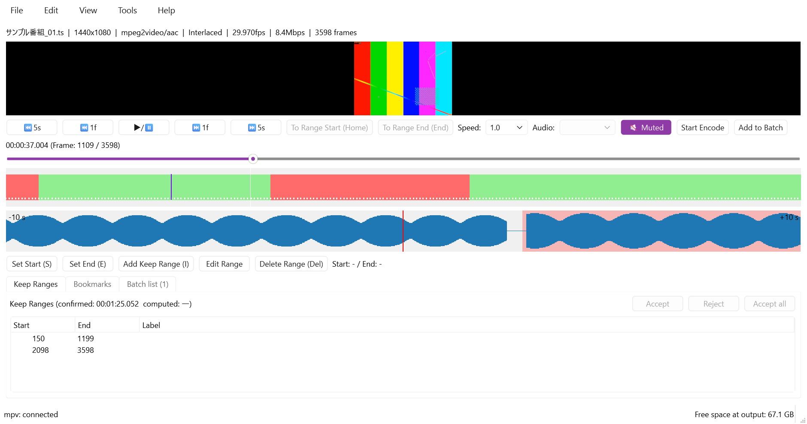

## 1. Open a recording

- Use File → Open (`Ctrl+O`), **drag and drop** onto the window, or File → Recent Files. TS files (`.ts` / `.m2ts` / `.mts`) are supported.
- The top line shows the resolution, codec, **scan type** (progressive / interlaced / soft telecine / mixed), fps, bitrate and frame count. Re-encoded parts are made to match this codec, scan type and bitrate.
- For broadcast recordings it also shows the station, programme title and air time (read from the programme information in the recording).
- A variable frame rate (VFR) recording shows a warning: Smart Cut can't be used and cuts fall on keyframes (Simple Copy).

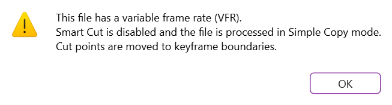

- A recording with **two or more audio tracks** (secondary audio, commentary...) asks every time it is opened. Compare them with the position slider and playback (switching during playback keeps the position) and choose the audio for the output. **Only the chosen audio** goes into the output. You can change it later with "Audio" under the preview or by right-clicking the batch item.

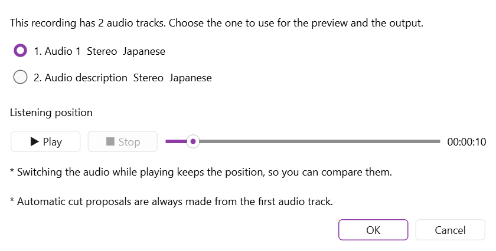

## 2. Make keep ranges

A range is the part **kept in the output** (the programme). Everything outside the ranges (commercials, before/after the programme) is removed.

1. Move to the start of the programme in the preview (`Space` play/stop, `←` `→` one frame, `<` `>` keyframes, the seek bar, the mouse wheel). The time field shows the time and frame number.
   - Opening a recording never starts playback, and sound starts muted (the Mute button or `M` toggles it). Frame steps are silent.
   - Drag the seek bar's handle, or click its groove to move there.
   - The waveform under the preview shows ±10 s around the current position (red line). Commercial breaks show up as silence. Removed parts are shaded red. Click to move there.
2. Press `S` for Start, `E` for End at the end of the programme part (just before the commercials), and `I` to add the keep range.
3. Repeat for each programme part. On the timeline, keep ranges are green and removed parts red. The list header shows the total length of the keep ranges (= the output length); "computed" includes the automatic proposals.

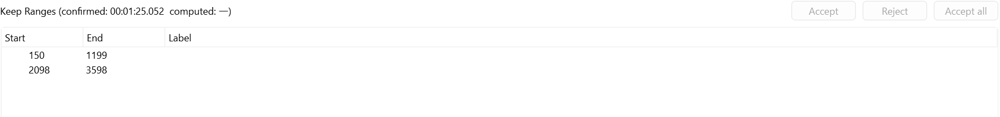

4. Press `B` to bookmark a position.

**Fixing a range**

- Clicking a row moves to the range's start. **With the row selected**, `S` / `E` set that range's start / end to the current frame (the row stays selected, so you can fix both ends in turn).
- `Home` / `End` (buttons next to ⏭5s) move to the selected row's start / end.
- `Esc`, or a click on empty space in the list, clears the selection; `S` / `E` then start a new range again.
- Double-click a row, or use Edit Range, to type the start and end frame numbers.
- `Del` deletes a range; Edit → Clear All deletes everything. All of these can be undone with `Ctrl+Z`.

The tabs at the bottom (Keep Ranges, Bookmarks, Batch list) can be shown or hidden one by one from the View menu.

Save your work with File → Save Project (`Ctrl+S`) and continue later with File → Open Project, which also opens the recording.

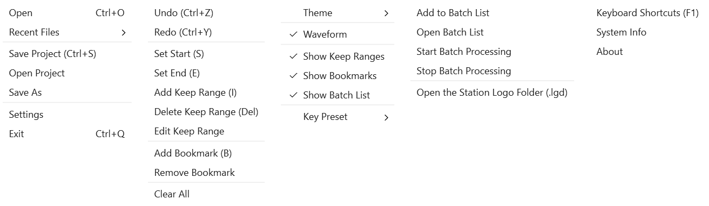

## 3. Automatic cut proposals

Opening a broadcast recording (a TS with the EIT and TOT programme information) proposes keep ranges from silence, scene changes, the station logo, commercial lengths (multiples of 15 s) and the air time. TS files made by ffmpeg or by this app have no programme information, so they get no proposals.

1. A "Loading" window shows the steps: file information, programme information, preparing the proposals. Preparing takes 20–90 seconds per recording (recordings cut before are faster). Press "Edit without waiting for proposals" to start editing at once.

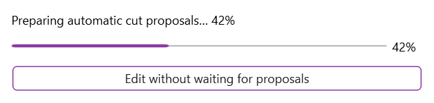

2. Proposals appear after the keep ranges as **blue rows** (confidence and reason), and as blue bars under the timeline and the waveform. Clicking a row moves to its start.
3. Decide with Accept / Reject / Accept all next to the header (or the right-click menu). Accepting makes it a keep range; rejecting removes it and moves to the next proposal. All can be undone with `Ctrl+Z`.
4. Fix a proposal's boundaries after accepting it (select the row and press `S` / `E`, or use Edit Range).
5. Adding to the batch with undecided proposals asks first (undecided proposals are not part of the keep ranges).

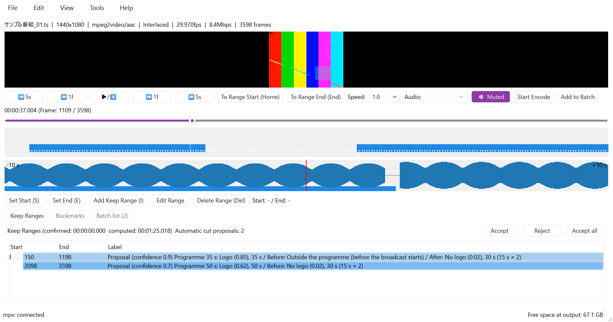

- Proposals are made once, when the recording is opened. To see rejected ones again, open the recording again (the current editing is lost). Recordings opened while a batch or encode runs get no proposals.
- **Cut records**: writing a recording in a batch stores the kept ranges and the recording's features (loudness, scene changes, the four corners for logos — never the video itself) in the history DB `cut_history.db`, and later proposals use them. After two recordings of a station, a station logo template is made and the proposals improve. A recorded recording shows "Registered" at the start of the file information line.
- Features are computed right after each batch item is written. Don't move or delete the recording until the item is Done. The app can't be closed while features are computed.
- **Exclude from the reference**: for a range cut in an unusual way (an episode whose opening was cut...), right-click it in the list or the timeline and choose "Exclude from learning". It stays recorded but is not used for evaluating proposals or learning.
- **Automatic threshold tuning**: the thresholds (silence level, commercial lengths...) are tuned from the recorded cuts after every batch (used only when better on recordings not used for the tuning; the status bar tells you). See them per station in Settings → Auto Cut → Thresholds.
- **Learning**: Settings → Auto Cut → Learning → Retrain... learns how to make proposals from the recorded cuts (used only when it beats the rules on the newest recordings). Choose the default method (rules / learning) there, and per station in the Stations and Logos table. Clear learning goes back to the rules (the recorded cuts are kept).
- **Importing station logos (.lgd)**: put station logo `.lgd` files (named `SID<number>-<n>.lgd`) in the `Logo/` folder next to the settings; they are imported when a recording is opened. Tools → Open the Station Logo Folder (.lgd) opens the folder. An imported logo is used until two recordings of the station have been cut (until the station logo template exists).
- **When a logo changes**: if the newest three cut recordings of a station all disagree with its logo template, the app asks whether to rebuild it. You can also rebuild it with Rebuild Logo... in Stations and Logos.
- **Exporting station logos (.lgd)**: Export Logo (.lgd)... in Stations and Logos writes the station logo made from the cut recordings as `.lgd` (usable for logo removal and logo detection; existing files are never overwritten). The station needs two or more cut recordings.
- Settings → Auto Cut → General turns the proposals and the logo-change notice on or off.

## 4. Write the output

- **Write now**: Start Encode (next to the playback buttons) writes the current keep ranges without the batch list. The window is locked while it runs, and the preview and seek bar follow the progress. Cancel in the status bar stops it.
- **Write several (batch)**:
  1. Register with Add to Batch or Tools → Add to Batch List. Each time it asks for the **output name**. **One item makes one file**: the keep ranges joined together. For a recording with several episodes, make the keep ranges per episode and add it several times under different names.

     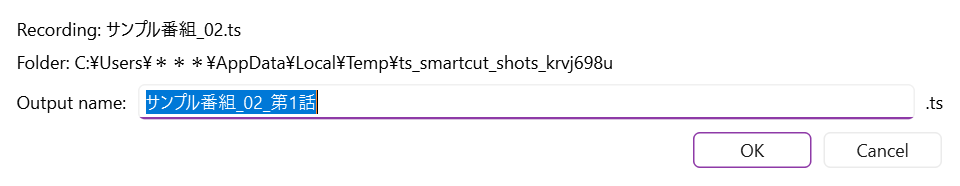

  2. Open other recordings and add them the same way.
  3. The batch list is one of the bottom tabs. Right-click an item to change its processing mode, output format, audio or output name. The Duration column shows the length after cutting. Clear removes finished items from the list.

     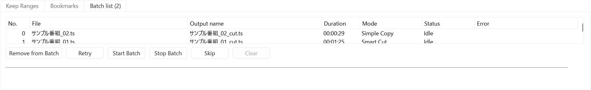
     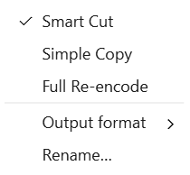

  4. Tools → Start Batch Processing writes them. You can keep editing meanwhile. A failed recording is skipped; fix the cause and use Retry.

**Processing modes** (default in Settings → Encoding; per item by right-clicking the batch list)

| Mode | What it does |
|---|---|
| Smart Cut | Re-encodes only around the cuts and copies the rest. Keeps the quality, fast, frame-accurate (default) |
| Simple Copy | Cuts at keyframes without re-encoding. Fastest, but cuts move to keyframes |
| Full Re-encode | Re-encodes all keep ranges with the source's codec, scan type and bitrate. Slow |

**Output formats** (Settings → Encoding; per item with right-click → Output format)

- **TS**: writes the cut video (default).
- **AVS / VPY**: writes no video but an AviSynth (`.avs`) / VapourSynth (`.vpy`) script that reads only the keep ranges of the source recording, together with a timecode file (`.timecode.txt`) and the audio of the keep ranges (`.flac`). The script reads the recording with L-SMASH Works and outputs 29.97i like the source. Use it to cut and encode in one pass with an encoder. A template lets you add filters.

## 5. Output files

- The output goes to "Output folder" in Settings → General; when it is empty (the default), to the source recording's folder (shown in the output name dialog).
- The suggested file name comes from "Output file name pattern" in Settings → General (default `{name}_cut{ext}`): `{name}` (source name), `{ext}` (extension), `{date}` (processing date `YYYYMMDD`), `{time}` (processing time `HHMMSS`).
- The extension is always the source's. A taken name gets a number such as `_001`; existing files are never overwritten, and neither is the source.
- While processing, a `.ts_smartcut_temp` folder holds temporary files in the output folder (removed afterwards). The right end of the status bar shows the free space of the output folder.

## 6. Settings

Open with File → Settings.

| Tab | Items |
|---|---|
| General | Number of recent files, output file name pattern, output folder |
| Preview | Audio output device, show / hide the waveform |
| Encoding | Default processing mode, output format (TS / AVS / VPY) and templates, threads, the hardware encoder detection result and Detect again |
| UI | Theme (light / dark / system), language (after a restart) |
| Shortcuts | Key presets (section 7) |
| Advanced | Logging on / off, log level |
| Auto Cut | General, Stations and Logos, Thresholds, Learning (section 3) |

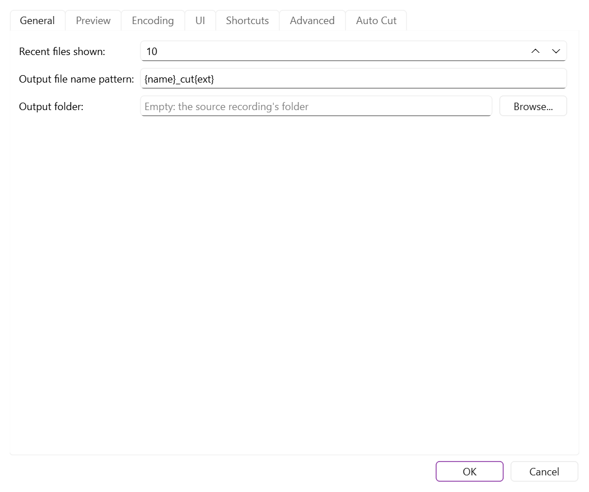
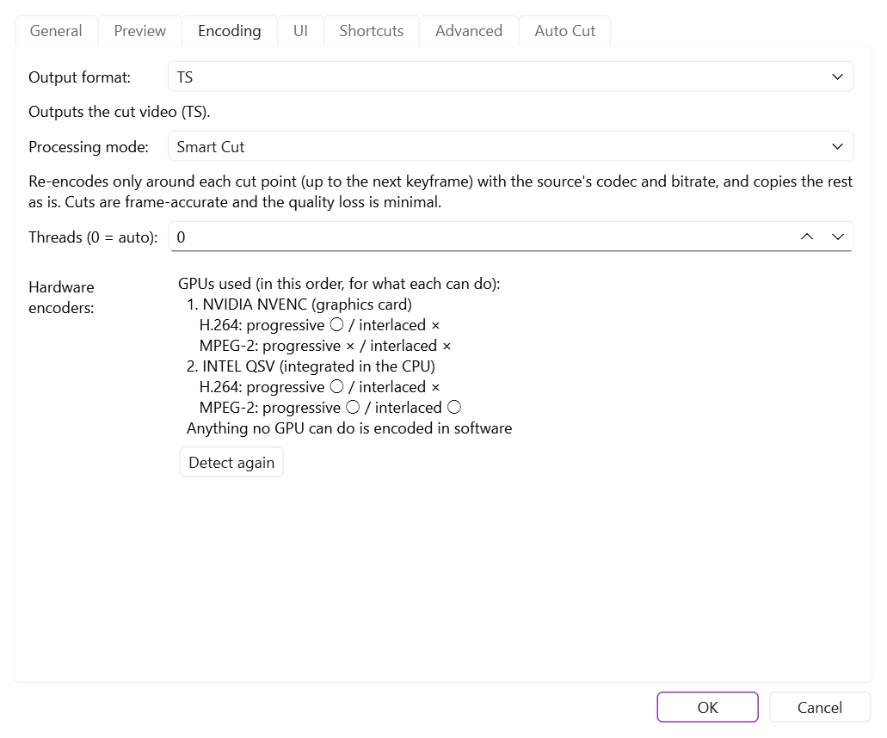
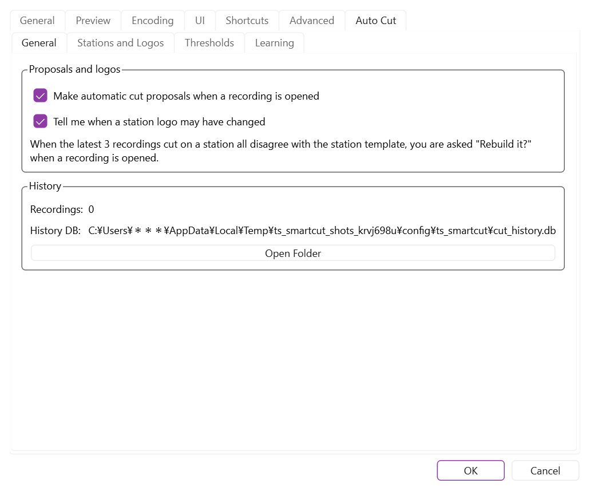

Help → System Info shows the OS, the ffmpeg and mpv versions and the hardware encoder detection result (Copy puts it on the clipboard for a bug report).

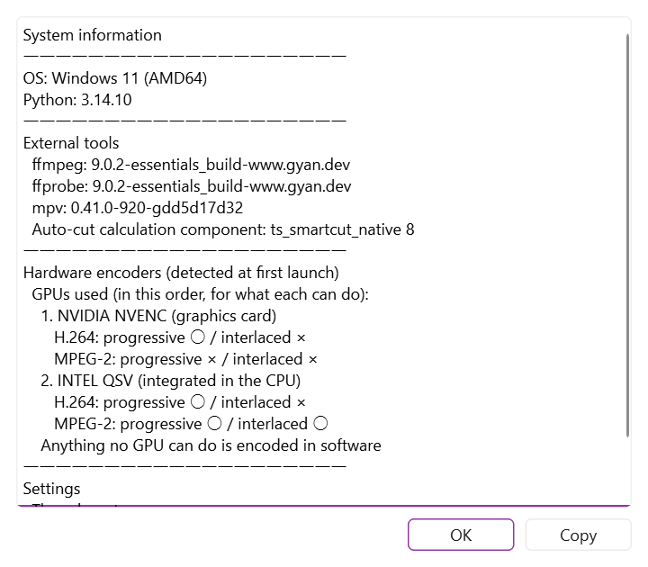

## 7. Keyboard shortcuts and key presets

Default keys (Help → Keyboard Shortcuts, or `F1`):

| Key | Action |
|---|---|
| `Space` | Play / pause |
| `←` / `→` | One frame back / forward |
| `<` / `>` | Previous / next keyframe |
| `[` / `]` | Slower / faster playback |
| `S` / `E` | Set Start / End (with a range row selected, fix that range's start / end) |
| `Home` / `End` | To the selected range's start / end |
| `Esc` | Clear the range selection |
| `I` | Add a keep range |
| `B` | Add a bookmark |
| `Del` | Delete the selected range |
| `M` | Mute / unmute |
| `Ctrl+Z` / `Ctrl+Y` | Undo / redo |
| `Ctrl+O` | Open a file |
| `Ctrl+S` | Save the project |
| `F1` | Keyboard shortcuts |
| `Ctrl+Q` | Quit |
| Mouse wheel | One frame (`Ctrl` + wheel: volume) |

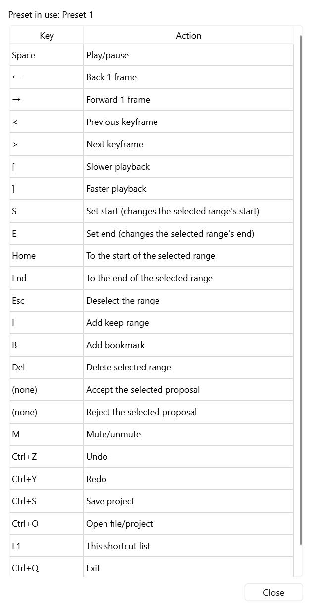

**Key presets** (Settings → Shortcuts)

- Keep up to **5** named sets of key assignments. Preset 1 holds the default keys. You can also switch with View → Key Preset.
- Select a key field and press the key to assign. Each action has one key. Assigning a key used by another action leaves that action unassigned, and a note says so. Clear removes an assignment.
- Accepting and rejecting proposals can have keys too (none by default).
- Reset to default keys puts the preset back to the default keys (its name stays).
- **Using a game controller**: a small Bluetooth controller that can act as a keyboard (a keyboard mode) works without extra software: assign the letters its buttons send to a preset and drive the app with one hand.

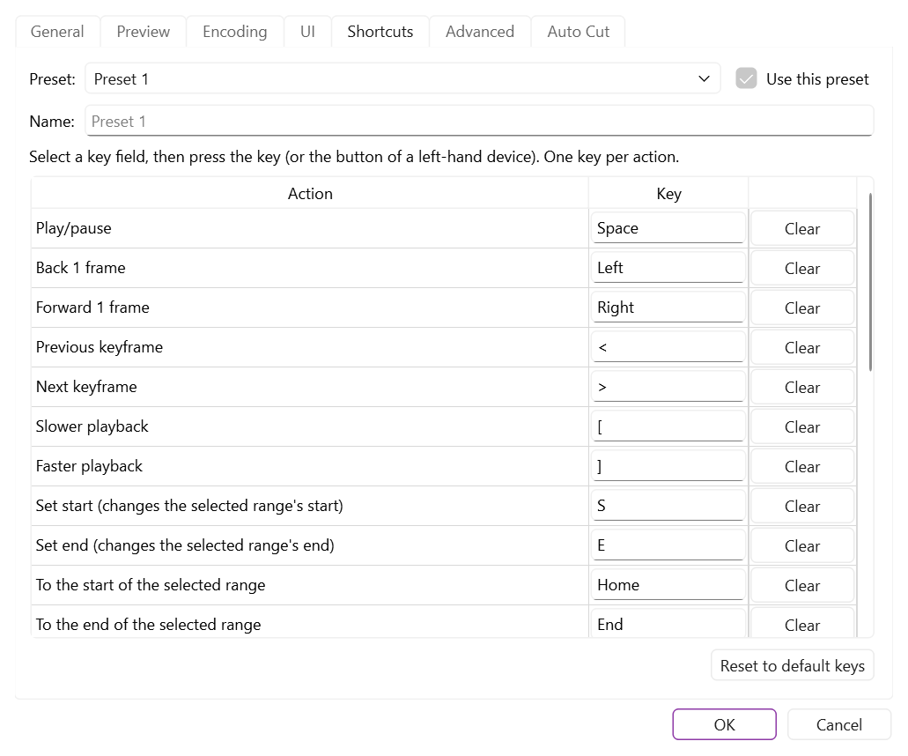

## 8. Network drives (shared folders)

Recordings on mapped drives (`Z:\...`), UNC paths (`\\server\share\...`) or shares mounted on Linux (Samba...) can be opened, and written to when the output folder is writable.

- **Nothing is created next to the recording.** The keyframe cache goes to `KeyframeCache/` next to the app, so recordings on read-only shares open too.
- **Processing time depends on the network.** Feature computation and Smart Cut's copy read the whole recording, and temporary files go to the output folder. A LAN is assumed.
- **If the connection drops while processing, that recording fails.** The partial output is deleted; leftovers in `.ts_smartcut_temp` are removed the next time processing starts in that folder.
- **Keep the app, its settings and the history DB on your own PC.** The history DB (SQLite in WAL mode) does not work correctly over a network.
