# TS_SmartCut 使い方

[English](User_Guide.md) | 日本語

インストールは [README_jp.md](../README_jp.md) にあります。

- [1. 録画を開く](#1-録画を開く)
- [2. 残す区間を作る](#2-残す区間を作る)
- [3. 自動カットの案](#3-自動カットの案)
- [4. 書き出す](#4-書き出す)
- [5. 出力](#5-出力)
- [6. 設定](#6-設定)
- [7. キーボードショートカットとキーのプリセット](#7-キーボードショートカットとキーのプリセット)
- [8. ネットワークドライブ（共有フォルダ）](#8-ネットワークドライブ共有フォルダ)

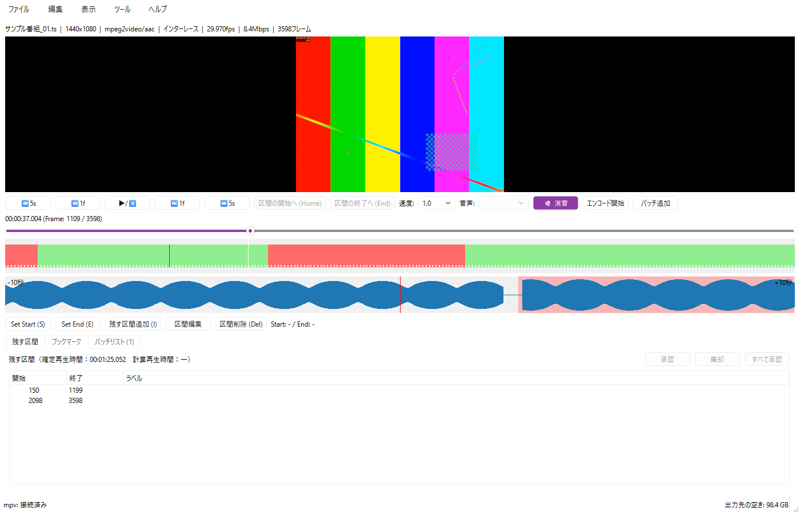

## 1. 録画を開く

- 「ファイル → 開く」（`Ctrl+O`）、ウィンドウへの**ドラッグ＆ドロップ**、または「ファイル → 最近使用したファイル」で開きます。対象は TS（`.ts` / `.m2ts` / `.mts`）です。
- 上の行に、解像度・コーデック・**走査方式**（プログレッシブ／インターレース／ソフトテレシネ／混在）・fps・ビットレート・フレーム数が出ます。再エンコードする部分は、このコーデック・走査方式・ビットレートに合わせて作ります。
- 放送の録画では、局名・番組名・放送日時も出ます（録画の中の番組情報から読みます）。
- 可変フレームレート（VFR）の録画では警告が出ます。VFR では Smart Cut が使えず、キーフレームの位置でのカット（Simple Copy）になります。

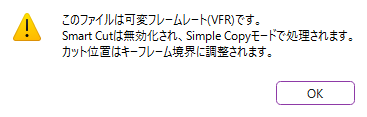

- **音声が 2 つ以上ある録画**（副音声・解説など）を開くと、毎回「音声の選択」が出ます。聞く位置のスライダーと再生で聞き比べて（再生中に切り替えても同じ位置のまま変わります）、出力に使う音声を選びます。出力に入るのは**選んだ音声だけ**です。後から、プレビューの下の「音声」や、バッチリストの項目の右クリック「音声」でも変えられます。

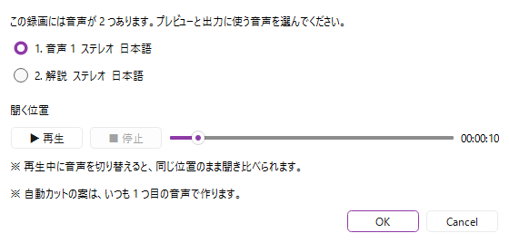

## 2. 残す区間を作る

区間は**出力に残す部分（本編）**です。区間の外（CM・番組の前後など）が消えます。

1. プレビューで本編の始まりへ移ります（`Space` 再生 / 停止、`←` `→` 1 フレーム、`<` `>` キーフレーム、シークバー、マウスホイール）。時間の欄に、時刻とフレーム番号が出ます。
   - 録画を開いても自動では再生しません。音は最初は消音です（「消音」ボタンか `M` で切り替え）。フレーム送りでは音は鳴りません。
   - シークバーは、つまみをドラッグするか、溝をクリックするとその位置へ移ります。
   - プレビューの下の音声波形は、今の位置（赤い線）の前後 10 秒です。CM の境目は無音として見えます。消える部分は赤く塗られます。クリックでその位置へ移ります。
2. `S` で Start、本編の終わり（CM の直前）で `E` で End を決め、`I` で残す区間に追加します。
3. 本編の数だけ繰り返します。タイムラインでは残す区間が緑、消える部分が赤です。リストの見出しに、残す区間の合計の時間（＝出力の長さ）が出ます。「計算」の時間は、自動カットの案も入れた長さです。

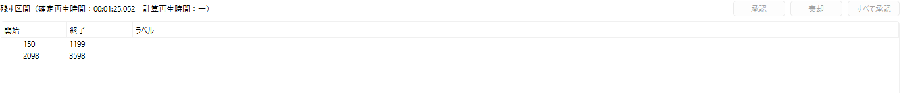

4. 気になる位置には `B` でブックマークを付けられます。

**作った区間を直す**

- リストの行をクリックすると、その区間の開始へ移ります。**行を選んだまま** `S` / `E` を押すと、その区間の開始 / 終了を今のフレームに直します（選んだままなので、開始と終了を続けて直せます）。
- `Home` / `End`（ボタンは ⏭5s の隣）で、選んだ行の開始 / 終了へ移ります。
- `Esc` か、リストの何も無い所のクリックで選択を外すと、`S` / `E` は新しい区間用に戻ります。
- 行をダブルクリックするか「区間編集」で、開始・終了のフレーム番号を打ち込んで直すこともできます。
- 削除は `Del`、全部消すのは「編集 → すべてクリア」です。どれも `Ctrl+Z` で戻せます。

下のタブ（残す区間・ブックマーク・バッチリスト）は、「表示」メニューでタブごとに出す・隠すを切り替えられます。

途中の状態は「ファイル → プロジェクトを保存」（`Ctrl+S`）で保存し、「ファイル → プロジェクトを開く」で続きから始められます。プロジェクトを開くと、記録されている録画も開きます。

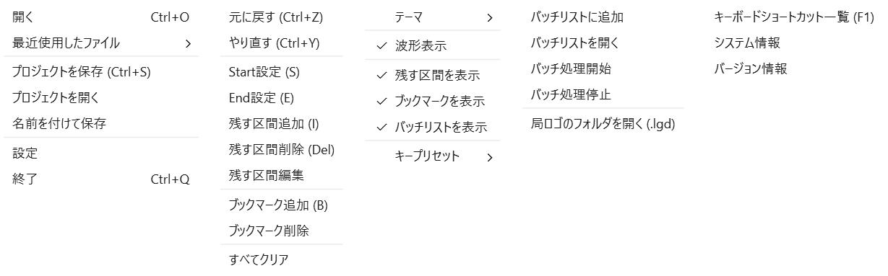

## 3. 自動カットの案

放送の録画（番組情報 EIT・TOT の入った TS）を開くと、無音・場面の切り替わり・局のロゴ・CM の長さ（15 秒の倍数）・放送時間から「残す区間の案」を作ります。ffmpeg で作った TS やこのアプリの出力には番組情報が無いので、案は出ません。

1. 録画を開くと「読み込み中」の窓が出て、ファイル情報・番組情報・案の準備の順に進みます。案の準備には録画 1 本で 20〜90 秒かかります（前にカットした録画は記録から作るので速い）。待たずに編集したい時は「案を待たずに編集する」を押します。

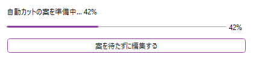

2. 案は残す区間のリストの後に**青い行**（確信度と判定の理由）で並び、タイムラインと音声波形の下側にも青い帯で出ます。行をクリックすると、その案の開始へ移ります。
3. 見出しの横の「承認」「棄却」「すべて承認」（右クリックでも）で決めます。承認すると残す区間になり、棄却すると消えて次の案へ移ります。どれも `Ctrl+Z` で戻せます。
4. 境目がずれている案は、承認してから直します（行を選んで `S` / `E`、または「区間編集」）。
5. 決めていない案を残したままバッチに追加しようとすると、確認が出ます（決めていない案は残す区間に入りません）。

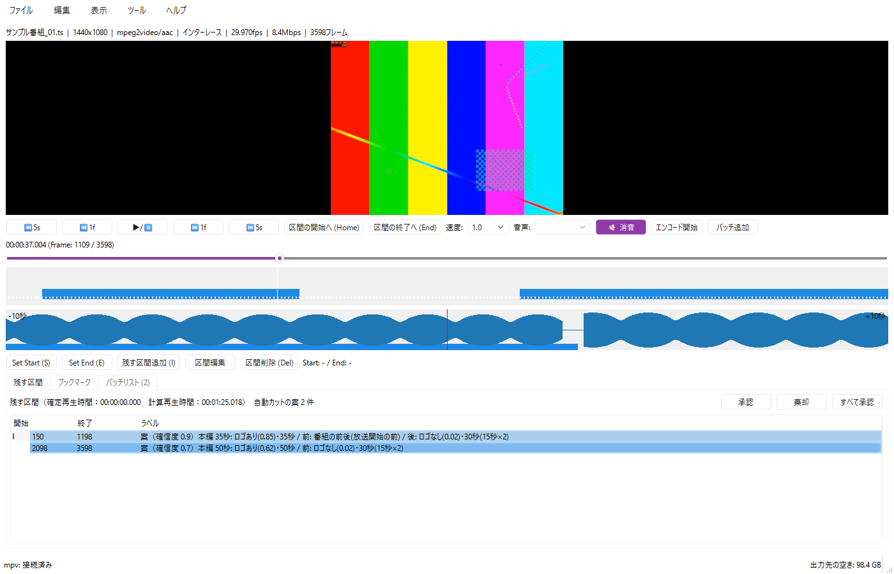

- 案は録画を開いた時に 1 回だけ作ります。棄却した案をもう一度見たい時は、録画を開き直します（今の編集は消えます）。バッチ処理・エンコードの最中に開いた録画には案を作りません。
- **カットの記録**: バッチで書き出すと、残した区間と録画の特徴（音量・場面の切り替わり・四隅のロゴ。映像そのものは保存しません）が記録 DB `cut_history.db` に入り、次からの案に使われます。同じ局の録画が 2 本たまると局のロゴの型ができ、案が良くなります。記録した録画を開くと、ファイル情報の行の先頭に「登録済み」と出ます。
- 録画の特徴は、バッチの各項目を書き出した直後に計算します。項目が Done になるまで、録画を移したり消したりしないでください。計算の間はアプリを閉じられません。
- **基準外**: いつもと違う切り方をした区間（OP を切った回など）は、リストかタイムラインを右クリックして「基準外にする」を選びます。記録には残りますが、案の評価と学習には使いません。
- **しきい値の自動補正**: 判定のしきい値（無音の音量・CM の長さなど）は、バッチが終わるたびに記録したカットから自動で補正します（補正に使っていない録画で良くなった時だけ使い、ステータスバーで知らせます）。今の値は「設定 → 自動カット → しきい値」で局ごとに見られます。
- **学習**: 「設定 → 自動カット → 学習」の「学習し直す...」で、記録したカットから案の作り方を学習します（新しい録画で確かめ、ルールより良い時だけ使います）。既定の方式（ルール / 学習）はこのタブで、局ごとの方式は「局とロゴ」の表で選べます。「学習をクリア」でルールに戻せます（記録したカットは消えません）。
- **局ロゴ（.lgd）の取り込み**: 局ロゴの `.lgd`（ファイル名 `SID<番号>-<n>.lgd`）を、設定と同じフォルダの `Logo/` に置くと、録画を開いた時に取り込みます。「ツール → 局ロゴのフォルダを開く (.lgd)」でフォルダを開けます。取り込んだロゴは、その局の録画が 2 本カットされるまで（局のロゴの型ができるまで）の案に使います。
- **ロゴが変わった時**: その局でカットした最新の録画 3 本が、どれも局のロゴの型と合わない時は「ロゴが変わった可能性があります。作り直しますか？」と聞きます。「設定 → 自動カット → 局とロゴ」の「ロゴを作り直す...」でも作り直せます。
- **局ロゴの書き出し（.lgd）**: 「局とロゴ」の「ロゴを書き出す（.lgd）...」で、カットした録画から作った局のロゴを `.lgd` として書き出します（ロゴ消し・ロゴの検出に使える形。同じ名前のファイルは上書きしません）。その局の録画が 2 本以上カットされている必要があります。
- 案を出すか・ロゴの変化を知らせるかは「設定 → 自動カット → 全般」で切り替えられます。

## 4. 書き出す

- **すぐ書き出す**: 再生ボタンの並びの「エンコード開始」で、今の残す区間を書き出します（バッチリストには入りません）。処理中は画面を操作できず、プレビューとシークバーが処理中の位置に動きます。ステータスバーの「中止」でやめられます。
- **まとめて書き出す（バッチ）**:
  1. 「バッチ追加」ボタンか「ツール → バッチリストに追加」で登録します。追加するたびに**保存名称**（出力のファイル名）を尋ねます。**1 つの項目の出力は 1 ファイル**で、残す区間をつないだ 1 つのファイルになります。1 本の録画に何話か入っている時は、話ごとに残す区間を作って、別の名前で何回か追加できます。

     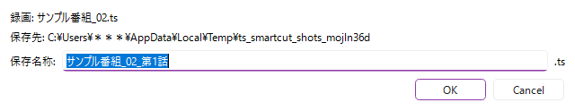

  2. 別の録画も同じように開いて、追加できます。
  3. バッチリストは下のタブの 1 つです。項目を右クリックすると、処理モード・出力形式・音声・保存名称を変えられます。「再生時間」の列はカット後の長さです。「クリア」で完了した項目を一覧から消せます。

     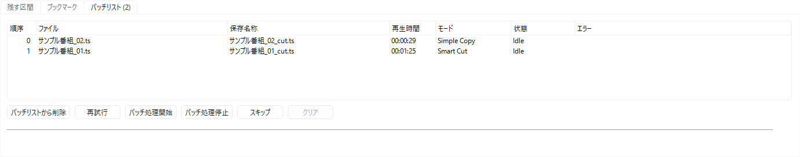
     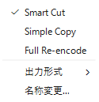

  4. 「ツール → バッチ処理開始」で書き出します。処理中も次の録画を編集できます。エラーになった録画は飛ばして次へ進みます。原因を直したら「再試行」でやり直せます。

**処理モード**（既定は「設定 → エンコード」、項目ごとにバッチリストの右クリック）

| モード | 内容 |
|---|---|
| Smart Cut | 切れ目の前後だけ再エンコードし、間はコピー。画質を保ち、速く、フレーム単位で正確（既定） |
| Simple Copy | キーフレームの位置でカット。再エンコードしない。最速だが、カットの位置がキーフレームにずれる |
| Full Re-encode | 残す区間を全部、元と同じコーデック・走査方式・ビットレートで再エンコード。時間がかかる |

**出力形式**（「設定 → エンコード」、項目ごとにバッチリストの右クリック「出力形式」）

- **TS**: カットした動画を出力します（既定）。
- **AVS / VPY**: 動画は出力せず、元の録画の残す区間だけを読む AviSynth（`.avs`）/ VapourSynth（`.vpy`）のスクリプトを書きます。一緒にタイムコード（`.timecode.txt`）と残す区間の音声（`.flac`）も書きます。スクリプトは L-SMASH Works で録画を読み、元と同じ 29.97i で出します。エンコードソフトに渡して、カットとエンコードを 1 回で行う時に使います。テンプレートを指定すると、フィルターなどを足せます。

## 5. 出力

- 出力先は元の録画と同じフォルダです（保存名称を尋ねる画面に「保存先」として出ます）。
- ファイル名の初めの案は「設定 → 全般」の「出力ファイル名パターン」で決まります（既定 `{name}_cut{ext}`）。置き換え文字は `{name}`（元のファイル名）・`{ext}`（拡張子）・`{date}`（処理日 `YYYYMMDD`）・`{time}`（処理時刻 `HHMMSS`）です。
- 拡張子は常に元と同じです。同じ名前のファイルがあれば `_001` などの番号を付け、今あるファイルは上書きしません。元の録画も上書きしません。
- 処理中は、出力先に `.ts_smartcut_temp` フォルダを作って一時ファイルを置きます（終われば消えます）。ステータスバーの右端に、出力先の空き容量が出ます。

## 6. 設定

「ファイル → 設定」で開きます。

| タブ | 項目 |
|---|---|
| 全般 | 最近使用したファイルの数、出力ファイル名パターン |
| プレビュー | 音声出力デバイス、音声波形の表示 / 非表示 |
| エンコード | 既定の処理モード、出力形式（TS / AVS / VPY）とテンプレート、スレッド数、ハードウェアエンコーダーの判定結果と「再判定」 |
| UI | テーマ（ライト / ダーク / OS に従う）、言語（再起動後に反映） |
| ショートカット | キーのプリセット（下の 7） |
| 詳細 | ログの有効 / 無効、ログレベル |
| 自動カット | 全般・局とロゴ・しきい値・学習（上の 3） |

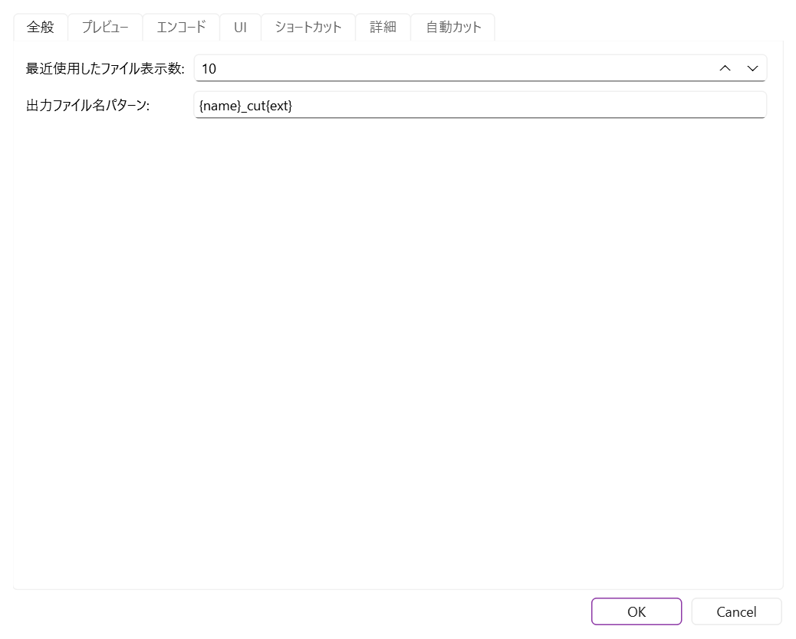
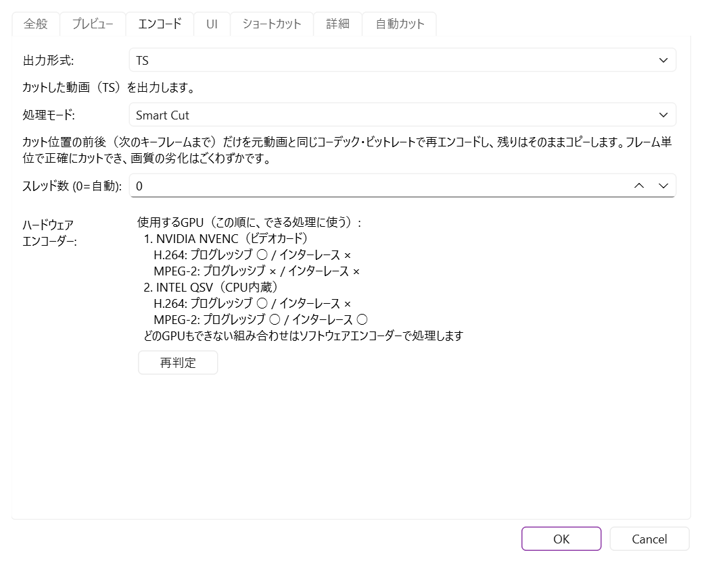
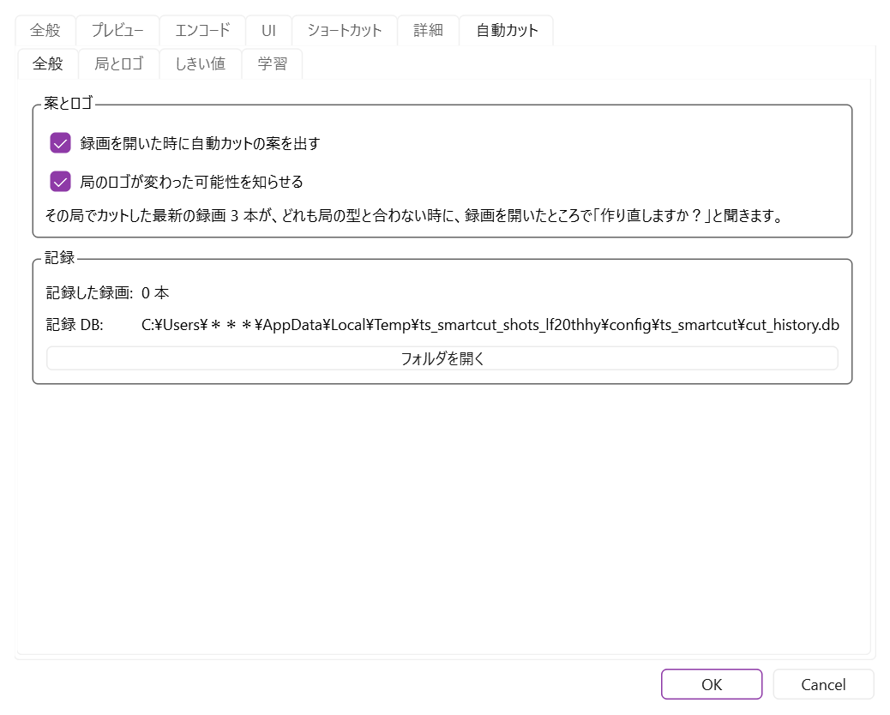

「ヘルプ → システム情報」で、OS・ffmpeg・mpv の版とハードウェアエンコーダーの判定結果を見られます（「コピー」で問い合わせに貼れます）。

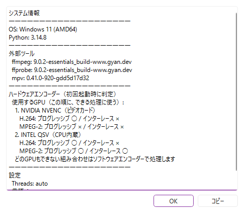

## 7. キーボードショートカットとキーのプリセット

既定のキー（「ヘルプ → キーボードショートカット一覧」または `F1`）:

| キー | 動作 |
|---|---|
| `Space` | 再生 / 一時停止 |
| `←` / `→` | 1 フレーム戻る / 進む |
| `<` / `>` | 前 / 次のキーフレームへ |
| `[` / `]` | 再生速度を下げる / 上げる |
| `S` / `E` | Start / End を決める（区間の行を選んでいる時は、その開始 / 終了を直す） |
| `Home` / `End` | 選んだ区間の開始 / 終了へ |
| `Esc` | 区間の選択を外す |
| `I` | 残す区間を追加 |
| `B` | ブックマークを追加 |
| `Del` | 選んだ区間を削除 |
| `M` | 消音 / 音を出す |
| `Ctrl+Z` / `Ctrl+Y` | 元に戻す / やり直す |
| `Ctrl+O` | ファイルを開く |
| `Ctrl+S` | プロジェクトを保存 |
| `F1` | ショートカット一覧 |
| `Ctrl+Q` | 終了 |
| マウスホイール | 1 フレーム移動（`Ctrl` + ホイールで音量） |

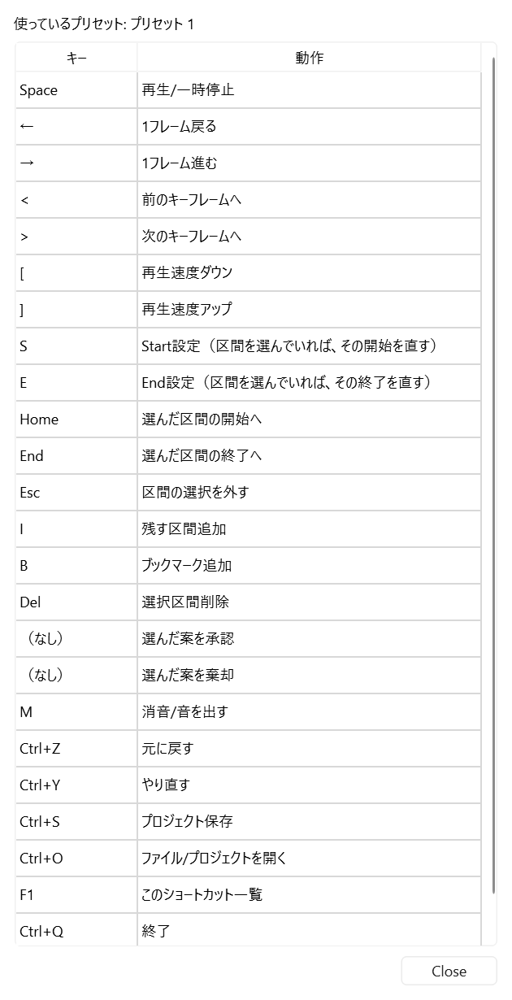

**キーのプリセット**（「設定 → ショートカット」）

- キーの割り当てを、名前を付けて **5 つまで**持てます。プリセット 1 は既定のキーです。「表示 → キープリセット」でも切り替えられます。
- キーの欄を選んでから、割り当てるキーを押します。1 つの操作にキーは 1 つです。ほかの操作に使っているキーを割り当てると、そちらは「（なし）」になり、下にその知らせが出ます。「外す」で割り当てを消せます。
- 案の「承認」「棄却」にもキーを割り当てられます（既定は無し）。
- 「既定のキーに戻す」で、そのプリセットを最初のキーに戻せます（名前はそのまま）。
- **ゲームパッドで操作する**: キーボードとして動く（キーボードモードのある）小型の Bluetooth コントローラーなら、ボタンが送る文字をプリセットに割り当てて、片手で操作できます。追加のソフトは要りません。

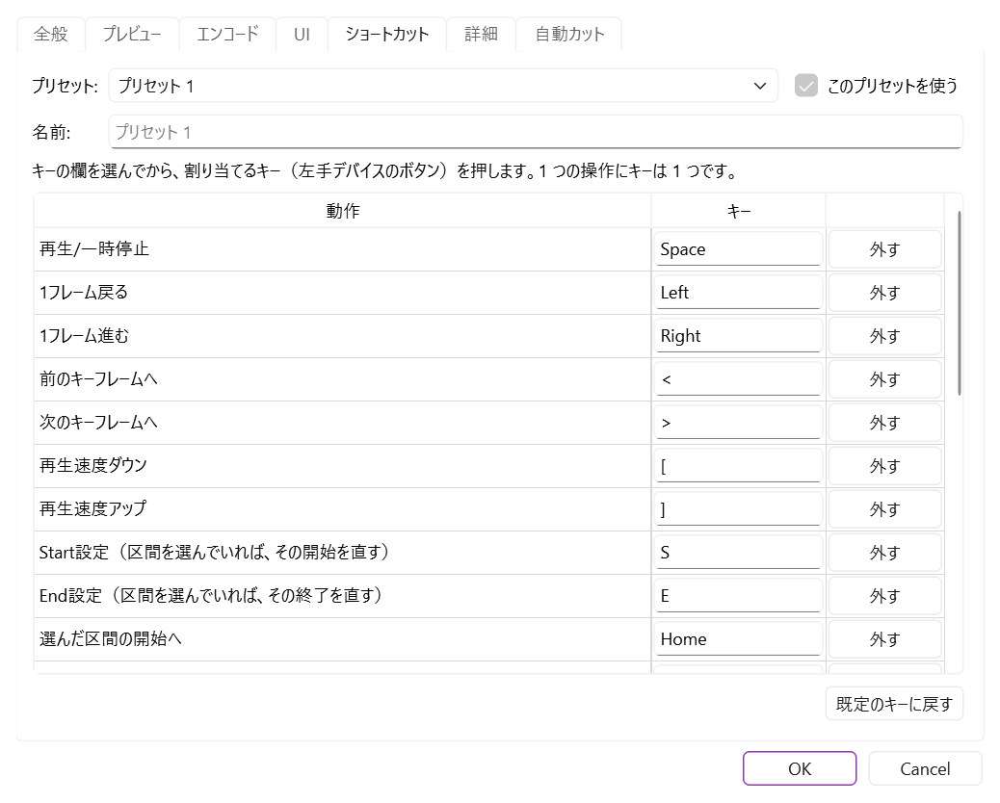

## 8. ネットワークドライブ（共有フォルダ）

割り当てたドライブ（`Z:\...`）、UNC パス（`\\server\share\...`）、Linux でマウントした共有（Samba など）の録画を開けます。出力先に書き込めれば、そこへ出力もできます。

- **録画のあるフォルダには何も作りません。** キーフレームの一覧のキャッシュはアプリの横の `KeyframeCache/` に作るので、読み取り専用の共有の録画も開けます。
- **回線の速さで処理の時間が変わります。** 特徴の計算と Smart Cut のコピーは録画をまるごと読み、一時ファイルも出力先に作ります。LAN の中での利用を想定しています。
- **処理中に回線が切れると、その録画はエラーになります。** 作りかけの出力は消し、`.ts_smartcut_temp` に残ったものは次に同じ出力先で処理を始めた時に消えます。
- **アプリと設定・記録 DB は自分の PC に置いてください。** 記録 DB（SQLite の WAL）は、ネットワークの上では正しく動きません。
